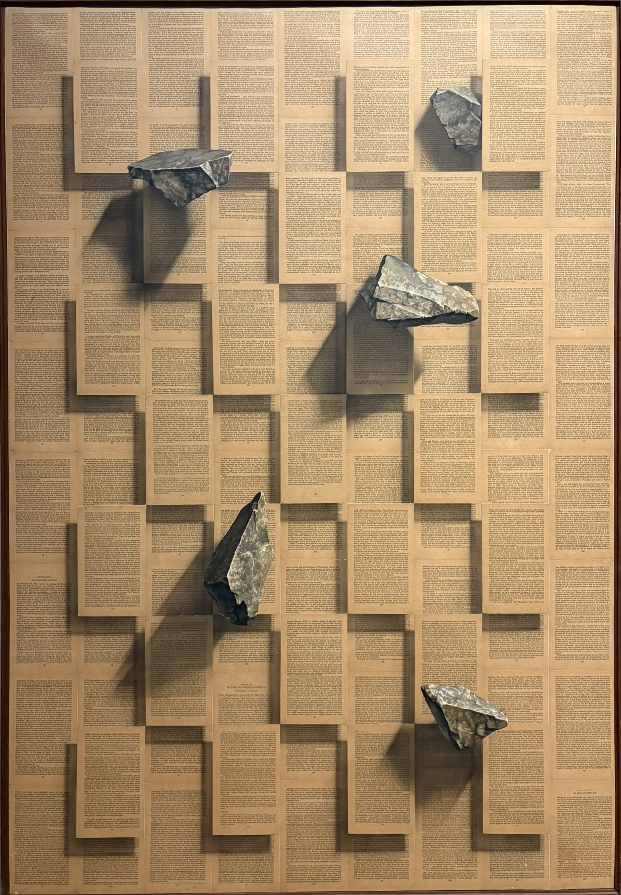

<blockquote style="padding: 1.5rem; background:transparent">
    
    

    고영훈, ⟪스톤북⟫(Stone Book), 1985년 作 / 책 낱장에 아크릴릭 물감, 142 x 98cm / 2025년 6월 26일, <a href="https://www.mmca.go.kr/exhibitions/exhibitionsDetail.do?exhFlag=1&exhId=202501060001886">MMCA 서울 상설전 «한국현대미술 하이라이트»</a>에서 필자가 촬영 
</blockquote>

## 들어가며: 가속에 저항하는 일

<blockquote style="padding: 1.5rem; background:transparent">
    빠른 과학은 단순히 속도의 문제가 아니라 속도를 늦추지 말고 시간을 낭비하지 말라는 명령이자, 그렇지 않으면…과 같은 식의 경고를 의미한다.   이 ‘그렇지 않으면(or else…)’이라는 표현은 추락의 가능성을 상기시킨다. 과학자가 자신의 삶 전체를 과학이라는 소명에 헌신하지 않으면 그 소명을 배신하게 된다는 고귀한 요구와 연관 지어 생각하기 쉽다.  
그러나 이러한 헌신이 얻어지고 유지되는 방식, 즉 상상력을 억제하면서 주의력과 열의를 일정한 방향으로 유도하는 훈련에는 고귀함이 전혀 없다. 

   <h6>이자벨 스탱게르스, 장하원 및 김연화 옮김, ⎡다른 과학은 가능하다 - 느린 과학 선언(Another Science is Possible: A Manifesto for 'Slow Science')⎦(2017), 에디토리얼, 2025</h6>
</blockquote>

 

**[🦜AI 윤리 레터](https://ai-ethics.kr/author/kevin/)에 지난 네 달 동안 네 편의 뉴스 브리프를 기고했습니다.** 평소에는 형식에 크게 구애받지 않는 글들을 써온 터라, 이천 명에 육박하는 독자에게 읽힐 평이한 문장을 써내는 데 많은 어려움을 겪었습니다. 정보 전달을 우선으로 하는 브리프의 경우 "최근에 이런 일이 있었구나"를 갈무리해주는 일이 우선인데, 장르의 본분을 망각하고 에세이의 구조로 써내려 갔던 것도 잦은 퇴고의 화근이 되었습니다. 이 지난한 과정을 인내하고, 지켜봐 주시며, 피드백에 많은 시간을 쏟아 주신 윤리레터 필진 분들께 진심으로 감사의 말씀을 드립니다. 

[사람의 글이 인터넷 세상에서 과반의 비중을 잃은 지](https://www.euractiv.com/opinion/humans-are-now-the-minority-online/)도 꽤 되었습니다. 트랜스포머(Transformer)의 발현으로, 그 어떤 매체보다도, 텍스트의 생산 속도는 전례 없는 수준으로 빨라졌습니다. 그 과정에서 사람이 어떻게 바뀌어 왔는지 그리고 어떻게 바뀔 것인지에 대해서는, 유수의 도서들이 이야기해 주고 있으니 여기서는 이만 줄이겠습니다. 다만 자신의 읽고 쓰기가 그 과정에서 어떻게 변해 왔는지, 스스로를 탐문해 온 르포르타주 형식의 글은 많이 찾기 어려웠습니다. (사실 제 견문이 부족한 탓일수도 있습니다.)  

여러분이 웹이라는 넓은 바다에서 잠시 머물고 계신 이곳은, 컴파일러와 프로그래밍 언어론, 모바일 애플리케이션 개발과 에세이, 그리고 기술철학이 한데 모여 진동하는, 참으로 이상한 모퉁이입니다. [**🌲월간, 수풀 아카이브**](https://soople.site/soople/)가 다루는 이야기는 더욱 특이하죠. (미학이라 명명하기도 부끄러운) 미학이나 매체 예술, SF와 교육, 그리고 사회의 명명에 이르기까지 폭넓은 서사를 다룹니다. 아무튼 인간의 글이 명맥을 유지하는 이곳은 저에게는 작은 쉼터입니다. 여러분에게도 그랬으면 좋겠네요. 골아픈 이야기를 하지만, 한편으로는 한 줄 요약이 존재하지 않는 세계에서 가끔 머물다 가셨으면 좋겠습니다.

아무튼 이 글이 차지하고 있는 이처럼 작은 방에서도, 저는 저의 이야기를 펼쳐나가고자 합니다. 전공자로서의 자아를 잠깐 내려놓고, 상처 투성이의 뾰족한 사람으로 써내어 보고자 합니다. 에세이로 이야기하고 싶었지만, 뉴스 브리프로 도출했던 것들에 대해, 다시 에세이로 환원하며 그때의 기록과 지금의 생각을 대조하고 또 다음에 올 이야기들을 다듬어 보고자 합니다. 뉴스 브리프에 대한 회고라니, 기자가 자신의 아티클을 평론하는 꼴인 듯 하지만, 제 마음이 가는 대로 스스로를 두들기려 합니다. 

**(각 섹션 첫머리에 붙인 사진을 클릭하면 뉴스레터 원문이 실린 페이지로 이동합니다.)**

 

## 회귀하는 인간들이 많아진다

<blockquote style="padding: 1.5rem; background:transparent">
    
    

    <a href="https://betterimagesofai.org/images">IceMing</a> &amp; <a href="https://digital-dialogues.co.uk/">Digit</a> / <a href="https://betterimagesofai.org/images?artist=IceMing&title=StochasticParrotsatWork">Stochastic Parrots at Work</a> / <a href="https://creativecommons.org/licenses/by/4.0/">Licenced by CC-BY 4.0</a>
    

"AI는 의식을 가질 수 있을까요?"라는 질문은 기술-가속 사회에서 점차 힘을 잃는 질문인 것만 같습니다. 대신 사람들은 그 질문에 이제 이렇게 답합니다. "그들이 의식을 가지는 건 중요하지 않아, 중요한 건 내가 무언가를 잃고 있다는 사실이야"라고요. 눈 앞의 편의를 위해 최전선의 기술에 꾸준히 투자하고 있는 저조차도 - 여러분과 함께 '내려놓고 있는 것'에 대해 생각해 볼 시간을 가지고 싶습니다.
</blockquote>

 

## 가치있는 유일한 일의 재구성

<blockquote style="padding: 1.5rem; background:transparent">
    
    

    <a href="http://kathrynconrad.com/">Kathryn Conrad</a> / <a href="https://betterimagesofai.org/images?artist=KathrynConrad&title=Datafication">Datafication </a> / <a href="https://creativecommons.org/licenses/by/4.0/">Licenced by CC-BY 4.0</a>
    

    2세기의 누군가는 "오직 교육만이 영원하고 성스럽다"라고 적었습니다. AI가 우리의 자격화 미션을 침식할수록, 바예호가 옮긴 그 문장은 빛이 바래는 게 아니라 오히려 선명해지는 것 같습니다. 남는 것은 사회화와 주체화, 곧 함께 살아가고 스스로 생각하는 법을 배우는 일이거든요. 앞으로 '가치있는 유일한 일'이 마주해야 할 지난한 변화의 여정에서, 그 무엇보다도 사회화와 주체화의 준칙이 지켜지기를 바랍니다.
</blockquote>

## 오독이 조문이 될 때

<blockquote style="padding: 1.5rem; background:transparent">
    
    

    <a href="https://profiles.cardiff.ac.uk/staff/kiddjc2">Jenny Kidd</a> &amp; <a href="www.syntheticpasts.com">Synthetic Pasts</a> / <a href="https://betterimagesofai.org/images?artist=JennyKidd&title=Algorithmicmemory">Algorithmic memory</a> / <a href="https://creativecommons.org/licenses/by/4.0/">Licenced by CC-BY 4.0</a>
    

    오독은 누구나 합니다. 다만 그 오독을 조문에 적어 넣을 수 있는 자리는 몇 개뿐이고, 우리는 그 자리에 앉아 있지 않습니다. 제가 소설을 잘못 읽으면 감상문 한 편이 남지만, 법안을 쓰는 사람이 잘못 읽으면 1억 건의 얼굴이 움직입니다. 그러니 필요한 건 그들의 오독을 더 잘 읽어내는 능력이 아니라, 오독이 조문이 되기 전에 멈출 수 있는 자리입니다.
</blockquote>

## 투명한 워터마크 뒤에 선 우리

<blockquote style="padding: 1.5rem; background:transparent">
    
    

    히토 슈타이얼, ⟪태양의 공장⟫(Factory of the Sun), 2015년 作 / 2022년 8월 29일 <a href="https://www.mmca.go.kr/exhibitions/exhibitionsDetail.do?exhFlag=1&exhId=202202140001485">국립현대미술관 서울관</a>에서 필자가 촬영 / 작가, 앤드류 크랩스 갤러리, 뉴욕 및 에스더 쉬퍼, 베를린 제공
    

    기계의 검증을 신뢰하기 어려울 때, 기댈 수 있는 건 사람 사이의 '신뢰' 뿐입니다. 우리가 만들어 가야 할 투명성은 인간 사이의 신뢰를 대체하는 기술적 장치로 비롯될 수 없습니다.  최전선의 기술이 우리의 일상과 제도에 닿을 때, 기술의 작동과 한계를 투명하게 설명하고 질문할 수 있는 자리를 만드는 일. 그것이 지금 ‘투명한 워터마크’ 뒤에 선 우리가 마주해야 할 과제입니다.
</blockquote>

## 나가며: 외면할 수 없기에 하는 일

<blockquote style="padding: 1.5rem; background:transparent">
    
</blockquote>

 