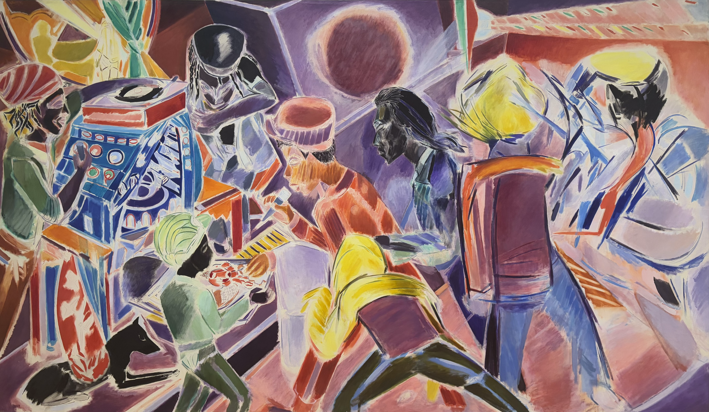

<blockquote style="padding: 1.5rem; background:transparent; box-shadow: -3px 3px 2px 0px #fdf5a6">
    
    

    
 Denzil Forrester (British, born Grenada, 1956) 作, <strong>⟪Dub⟫</strong>, 1985, Oil on canvas, 83 7/8 in. × 11 ft. 11 15/16 in. (213 × 365.6 cm), Copyright Denzil Forrester. Courtesy the artist and Stephen Friedman Gallery.

    
2025년 2월 6일, 뉴욕 메트로폴리탄 미술관(The Metropolitan Muesum of Art)에서 필자가 촬영.

    

    <strong style="background-color: #BADCF9; padding: 0.3rem"> 해당 아티클은 <a href="">유난무브먼트 펠로우십</a>의 일환으로 작성되었습니다. </strong>
</blockquote>

## 🔜 어떻게 보면 쓸모없는 일

## 🔜 새로운 축을 세우고 경청하는 일

## 문제의식을 구체화하고 다듬는 일

<blockquote style="padding: 1.5rem; background:transparent">

    

    <a href="http://kathrynconrad.com/">Kathryn Conrad</a> / <a href="https://betterimagesofai.org/images?artist=KathrynConrad&title=Datafication">Datafication </a> / <a href="https://creativecommons.org/licenses/by/4.0/">Licenced by CC-BY 4.0</a>
    

교양을 추구하던 2세기의 누군가는 이렇게 기록하고 있다.  
<i>“가치있는 유일한 일은 교육이다. 그 외의 모든 재산은 인간적이고 작으며 노력하여 추구할 만한 가치가 없다.
귀족이라는 타이틀은 고대인들의 유물이다. 부(富)는 있을 수도 없을 수도 있는 운명의 선물이다. 영예는 불완전하다. 아름다움은 순간적이며 육체는 불안정하다. 육체는 질병과 노화에 스러질 수밖에 없다.
오직 교육만이 영원하고 성스러운 것이다.
지성은 시간이 흐를수록 회춘하면서 과거의 지혜에 새로운 것을 더해가기 때문이다. 모든 것을 쓸어버리는 폭풍우 같은 전쟁도 누군가의 앎을 빼앗지는 못한다.”</i> 
— 이레네 바예호, <갈대 속의 영원>(El Infjinito en un Junco)
    

    아래는 대화모임 <a href="https://activity.soople.site">인공지능은 교육자의 꿈을 꾸는가</a>를 기획하며 작성했던 글을 다듬은 것입니다.
</blockquote>

### 가속의 논리와 잃어버린 숙고의 속도

유네스코 쿠리에 2026년 2분기호<h6>UNESCO (2026. 4–6), "Artificial intelligence: Do we still need to think?", The UNESCO Courier, 2026(2), ISSN 2220-2285, https://courier.unesco.org/en/latest</h6> 의 표제는 도발적입니다. "Artificial Intelligence: Do we still need to think" AI의 테두리 안에서 인간에게 여전히 생각이 필요한지 묻고 있습니다.

질문 자체는 새롭지 않습니다. 소크라테스는 글쓰기를 경계했고, 루소는 책을 의심했습니다. 자크 데리다(Jacques Derrida)의 표현을 빌리면 기술은 언제나 독과 약을 함께 지닌 '파르마콘(pharmakon)'이었습니다. <h6>자크 데리다 (Jacques Derrida), "La pharmacie de Platon", ⌜La dissémination⌟, Seuil, 1972.</h6> 기술이 배움을 앗아가리라는 예언 역시 인류 역사에서 되풀이했습니다. 문자와 책, 계산기에 사유를 맡겨 온 역사를 고려하면, 단지 '외주화는 나쁘다'는 명제만으로는 지금의 위기를 설명하기 어렵습니다.

차이는 학계와 현장이 이 예언을 데이터로 관측하기 시작했다는 점에 있습니다. 2024년 튀르키예 학생 1,000명을 대상으로 한 연구 <h6>Hamsa Bastani; Osbert Bastani; Alp Sungu; Haosen Ge; Özge Kabakçı; Rei Mariman (2025), "Generative AI without guardrails can harm learning: Evidence from high school mathematics", Proceedings of the National Academy of Sciences, 122(26), e2422633122, https://doi.org/10.1073/pnas.2422633122 </h6> 에 따르면, ChatGPT를 활용한 학생들은 도구를 제공할 때만 성적을 올렸습니다. 도구 접근을 차단하자 학생들은 도구를 전혀 써보지 않은 학생들보다 낮은 성취도를 보였습니다. 웨인 홈스(Wayne Holmes)는 이를 '인지적 목발(cognitive crutch)'이라 부릅니다. 교실에 진입하는 기술의 속도는 인간이 그 기술을 숙고하는 속도를 매번 앞지릅니다. 한국은 2025년 1학기에 AI 디지털교과서를 도입했으나 한 학기 만에 지위를 '교육자료'로 낮췄습니다. <h6>한상희; 임세원; 홍유진 (2025. 8. 4), "'AI 교과서 교육자료 격하' 초·중등교육법 개정안 본회의 통과", 뉴스1, https://www.news1.kr/politics/assembly/5868595</h6> 스웨덴은 1994년부터 교실에 스크린을 들였다가 국제학업성취도평가(PISA) 성적 저하를 경험하고 2024년 종이 교과서 보조금 정책으로 회귀했습니다. <h6>아멜리 라이히무트 (Amélie Reichmuth) (2026. 4–6), "Sweden: the unmet promises of the digital classroom", The UNESCO Courier, 2026(2), pp. 8–10, https://courier.unesco.org/en/articles/sweden-unmet-promises-digital-classroom</h6>

의문이 남습니다. 스웨덴은 30년에 걸쳐 천천히 기술을 도입했습니다. 속도가 문제였다면 30년은 성찰하기에 충분한 시간이었어야 합니다. 문제는 단순히 도입의 속도가 아닙니다. 교육의 성패를 '더 빠르게, 더 효율적으로'라는 단일 척도로 측정하는 '가속 논리'에 있습니다. 닐 포스트먼(Neil Postman)의 말처럼 모든 기술 적용이 하나의 거래라면, 가속 논리는 거래로 얻는 편의만 셈할 뿐 그 대가로 무엇을 내어주는지 묻지 않습니다. <h6>닐 포스트먼 (Neil Postman), 김균 옮김, ⌜테크노폴리: 기술에 정복당한 오늘의 문화(Technopoly)⌟(1992), 민음사, 2001.</h6>

우리가 교육의 원형을 되돌아볼 때 상실의 정체가 드러납니다. 교육철학자 게르트 비에스타(Gert Biesta)는 교육의 기능을 세 가지로 정리합니다. <h6>Gert Biesta, ⌜Good Education in an Age of Measurement: Ethics, Politics, Democracy⌟, Paradigm Publishers, 2010.</h6> 지식과 기술을 습득하는 '자격화', 공동체 안에서 자리를 찾는 '사회화', 그리고 스스로 생각하고 삶에 책임지는 '주체화'입니다. AI 튜터는 대부분 첫 번째 기능인 자격화만 담당합니다. 그러나 논쟁은 여전히 무엇을 얼마나 빨리 익힐 것인가에 머물러 있습니다. 부에노스아이레스의 한 교사는 "어떤 AI도 아이를 다정하게 바라보며 어깨에 손을 얹고 '널 믿는다'고 말할 수 없다"고 했습니다. <h6>나탈리아 파에스 (Natalia Páez) (2026. 4–6), "Argentine teachers divided over AI", The UNESCO Courier, 2026(2), pp. 18–19, https://courier.unesco.org/en/articles/argentine-teachers-divided-over-ai</h6> AI가 그 손이 수행하던 일들을 지금 조용히 비워 내고 있습니다.

이 빈자리에서 시민적 근육이 위축합니다. 즉답을 보장하는 환경은 타인의 생각과 차이를 견디며 숙의하는 힘을 약화합니다. 교육이 한나 아렌트(Hannah Arendt)가 말한 '복수성(plurality)', 즉 서로 다른 타인과 함께 살아가는 법을 익히는 장이라면 <h6>한나 아렌트 (Hannah Arendt), 이진우 옮김, ⌜인간의 조건(The Human Condition)⌟(1958), 한길사, 2019 (제2판).</h6>, 즉답의 환경은 그 장을 가장 먼저 해체합니다. 우리가 답변을 기다리는 불편함과 이견 사이에 머무는 시간을 '비효율'로 지우는 순간, 민주주의를 지탱하는 근육도 함께 퇴화합니다.

따라서 이 문제는 본질적으로 정치의 영역에 속합니다. 유네스코 쿠리에는 '뒤집힌 디지털 격차(flipped digital divide)'를 경고합니다. 자원이 풍부한 학생은 인간 교사를 만나고, 그렇지 못한 학생은 화면 앞에 남겨두는 구조입니다. 기계에 무엇을 위임할 것인가의 문제는 기술의 차원을 넘어 분배와 결정권의 문제입니다.

현장 역시 이 균열을 인지하고 있습니다. 《크로니클 오브 하이어 에듀케이션(Chronicle of Higher Education)》이 인용한 2026년 조사에서 대학 강사의 90%는 AI가 학생의 비판적 사고를 약화할 것이라 응답했고, 95%는 과의존을 우려했습니다. <h6>C. Edward Watson; Lee Rainie (2026. 1), "The AI Challenge: How College Faculty Assess the Present and Future of Higher Education in the Age of AI", American Association of Colleges and Universities·Elon University Imagining the Digital Future Center, https://imaginingthedigitalfuture.org/wp-content/uploads/2026/01/Elon-AACU-faculty-AI-survey-full-report-1-21-26.pdf — 2025년 10–11월 대학 교수진 1,057명 대상, 비확률 표본 조사</h6> 강사들은 문제의식을 품고 있습니다. 다만 현장은 이러한 문제의식을 멈춰 서서 숙고하고 동료와 공유할 시간적·공간적 여유를 주지 않을 뿐입니다. 이 기획이 포착하고자 하는 지점이 바로 여기입니다.

### 저속의 회복, 교실에 배움의 마찰을 남기는 일

만들고자 하는 변화는 선명합니다. 교사가 AI에 무엇을 맡기고 무엇을 지킬지 스스로 결정하며, 교실에 숙의의 속도를 복원하는 것입니다. 한마디로 '빠른 교육의 압박으로부터 저속을 회복하는 일'입니다.

저속이 단지 느림만을 의미하지는 않습니다. 결재를 지연하는 행정도 느리지만 거기에는 숙의가 없습니다. 회복하고자 하는 것은 속도 자체가 아니라, 타인의 생각을 견딜 수 있는 속도, 곧 숙의가 가능한 호흡입니다. 이 속도를 회복한다는 것은 배움에서 마찰을 제거하지 않는다는 뜻입니다.

AI 교육 기업가 프리야 라카니(Priya Lakhani)는 용이하고 빠른 답을 성찰과 혼동해서는 안 되며, 도전과 정신적 노력이 전문성을 형성한다고 지적합니다. <h6>Priya Lakhani (2025), "This is how kids should be learning with AI", TEDNext 2025, https://www.ted.com/talks/priya_lakhani_this_is_how_kids_should_be_learning_with_ai</h6> 현장은 마찰을 의도적으로 설계한 사례를 이미 보유하고 있습니다. 중국 구이저우의 홍옌(Hongyan) 프로젝트는 학생이 막혔을 때 정답 대신 "어느 지점에서 개념이 흐릿해졌는가?"를 묻도록 AI를 구축했습니다. <h6>왕정 (Wang Zheng) (2026. 4–6), "An intelligent solution to inspire young minds in rural China", The UNESCO Courier, 2026(2), pp. 20–21, https://courier.unesco.org/en/articles/intelligent-solution-inspire-young-minds-rural-china</h6> 뉴질랜드의 한 언어 교사는 "초안을 먼저 작성한 후 AI에 피드백을 구하라"는 규칙을 만들어 단순 복사·붙여넣기를 호기심과 비판적 검토로 전환했습니다. <h6>엘바 라미레스 (Elba Ramirez) (2026. 4–6), "Why studying languages still matters", The UNESCO Courier, 2026(2), pp. 11–13, https://courier.unesco.org/en/articles/why-studying-languages-still-matters</h6> 교사들이 이러한 마찰을 일상의 판단으로 교실에 뿌리내리기를 바랍니다.

변화의 주돌을 교사로 설정한 이유가 있습니다. 인도에서는 Z세대의 52%가 육아 조언에서 검색엔진보다 AI를 신뢰합니다. <h6>사이드 아마드 루파이 (Syed Ahmad Rufai) (2026. 4–6), "Parenting by prompt in India", The UNESCO Courier, 2026(2), pp. 22–23, https://courier.unesco.org/en/articles/parenting-prompt-india</h6> 교실 밖 성인들 역시 효율성에 끌려 비효율의 가치를 상실하고 있다면, 마찰을 수호할 책무는 학생에 앞서 어른이 집니다. 따라서 이 기획의 주어는 교사입니다. 교사가 공론장에서 확보한 판단력을 수업으로 전환할 때 학생은 비로소 변화의 주체로 진입합니다.

참가 교사가 "내 교실에서 지키고자 하는 마찰"을 한 문장으로 명료하게 규정할 수 있을 때 모임은 비로소 성공합니다. 교사가 막연한 우려를 한 문장의 실천적 판단으로 구체화할 때 변화를 시작합니다. 교사가 그 문장을 다음 학기 교실에서 수업으로 실현하는 순간, 변화는 비로소 학생에게 도달합니다. 첫 모임에서 다음 모임을 이끌 교사를 세우려는 이유도 동일합니다. 교사 공동체는 이 질문을 한 개인에 머물게 하지 않고 내부에서 지속해서 가동해야 합니다.

### 연대와 숙의를 위한 공론장으로서의 대화모임

초기에는 교육자의 실천 부족을 문제로 보았습니다. 그러나 강사의 90%가 우려를 표명한 데이터를 다시 검토하며 관점을 수정했습니다. 현장은 이미 문제의식을 축적하고 있었습니다. 결여한 것은 실천 의지가 아니라, 실천을 멈춰 서서 복기하고 숙의할 시간과 공간이었습니다.

고립된 개인 내부에서 숙의를 완성할 수는 없습니다. 한 교사의 고민은 사적인 문제로 격리하기 쉽습니다. 그러나 AI를 적극 활용한 교사, 의도적으로 배제한 교사, AI를 기본값으로 두고 출범할 예비교사가 한자리에 모일 때 구조가 변합니다. 서로 다른 실천적 판단이 충돌하는 지점에서 우리는 개인의 고민을 비로소 공적 의제로 전환합니다. 이 기획은 두 가지 가설에서 출발하여 모임을 통해 검증을 시도합니다.

매뉴얼이나 기존 연수가 아닌 '대화모임'을 선택한 까닭이 여기에 있습니다. 매뉴얼은 또 다른 '빠른 답'을 제공하는 데 그치기 쉽습니다. 반면 대화모임은 참여자들에게 서로 다른 판단 사이에 체류하는 시간 그 자체를 제공합니다.

현직·예비교사 14명 이상과 퍼실리테이터가 2시간 30분 동안 머무르는 구조로 모임을 기획했습니다. 텍스트 재료는 유네스코 쿠리에 2026년 2분기호와 이를 요약한 AI 윤리 레터 뉴스 브리프 <h6>16. 임승현 (2026), "가치있는 유일한 일의 재구성 - AI 행위자 시대에 교육은 어디에 서 있을까요", AI 윤리 레터, https://ai-ethics.kr/education-in-the-age-of-ai-2026-06-22/</h6> 입니다. 이미 논의를 공유해 온 네트워크에서 출발해야 첫 모임이 형식적인 연수를 넘어 진정한 공론장으로 작동합니다.

대화모임 「인공지능은 교육자의 꿈을 꾸는가」는 개인의 수업 장면에서 출발해 제도의 차원으로 확장하는 4단계로 구성합니다. 참가자들은 사전 과제로 제출한 수업 장면(AI를 활용했거나 일부러 배제한 경험)을 공유합니다. 이어 3분간 침묵을 거친 뒤 자신과 가장 다른 수업 장면을 글로 기록합니다. 이후 "교실에서 보존해야 할 마찰은 무엇인가"를 토론하고, 그 마찰을 지키기 위해 평가와 제도를 어떻게 바꿔야 하는지로 논의를 확장합니다. 마지막 단계를 제도의 영역으로 확장하는 이유는 개별 교사의 의지만으로 마찰 수호를 지속할 수 없기 때문입니다. 

이 모임이 일회성 이벤트로 소모하기를 경계합니다. 우리는 당일의 기록을 축적합니다. 참가자들이 작성한 14장 이상의 아이디어 카드와 공론장의 흐름을 정리한 뉴스레터 기록이 남습니다. 다음 모임은 이전 모임의 데이터를 텍스트로 삼고, 질문지를 수정하며, 참여자 중 공동 호스트를 배출합니다. 우리는 이 순환 과정에서 초기 가설의 지지와 반박 여부를 지속해서 검증합니다. 기록은 교육자 데이터베이스로 통합하며 기획 회고 문서와 함께 보존합니다. 우리는 데이터베이스에 성공 사례뿐 아니라 실패와 한계도 정직하게 기록합니다. 정답 모음집으로 전락하는 순간, 이 프로젝트 역시 스스로 비판했던 '빠른 답'의 생산자로 전락하기 때문입니다.

첫 모임의 목표는 완성된 시스템 구축이 아닌, 두 번째 모임을 실행할 수 있는 최소한의 구조(Minimum Viable Structure)를 만드는 일입니다. 데이터베이스의 틀, 첫 모임의 기록, 다음 질문지 초안을 설계하는 데 집중하고 순환의 완결은 다음 단계로 이관합니다.

### 말과 침묵 사이에서 얻는 주체적 언어

참가자가 가장 먼저 통과하는 경험은 '느리게 말하고 듣는 감각'입니다. 장면 공유 라운드에서 청자는 평가를 유예하고 질문만 던집니다. 3분간 침묵을 거친 후에야 비로소 글을 씁니다. 즉각적인 반응 대신 침묵 이후의 서술을 요구하는 이유는, 회복하고자 하는 숙의의 속도를 언어가 아닌 감각으로 체화하도록 이끌기 위함입니다.

이어 참가자는 '서로 다른 실천적 판단의 동시적 청해'를 경험합니다. AI를 도입한 교사와 거부한 교사가 같은 테이블에 앉아 각자의 근거를 공유합니다. 목표는 인위적인 합의가 아닌, 차이 자체에 머무르는 견딤입니다.

모임 종료 후 유의미한 변화가 일어납니다. 참가자는 막연한 불안을 "내 교실에서 이것만큼은 AI에 위임하지 않겠다"는 선명한 언어로 전환합니다. 참가자는 카드에 적은 구체적 실천 하나를 손에 쥐고 돌아갑니다. 고립감을 해소하며, 동일한 고민을 통과하는 동료의 존재를 확인합니다. 이는 다음 모임의 공동 호스트 참여로 이어집니다. 무엇보다 느린 대화와 침묵이 가능하다는 신체적 기억을 남깁니다.

### 교실에서 시작되는 작은 민주주의

일상의 민주주의는 거대한 제도의 정립이 아닌, 결정에 앞서 한 번 더 멈춰 서는 질문의 습관에서 출발합니다. 이 기획이 목표로 하는 민주주의의 장면은 세 지점에서 모습을 드러냅니다.

첫 번째 장면의 장소는 교무실입니다. 교사가 새로운 AI 도구 도입을 논의할 때 "무엇을 할 수 있는가"가 아닌 "무엇을 맡기지 않을 것인가"를 먼저 묻습니다. 도구를 사용한 교사와 사용하지 않은 교사가 함께 가이드라인을 그려 나갑니다. 아랍에미리트(UAE)의 한 학교가 AI 활용 범위를 신호등 체계(빨강: 자율, 노랑: 지도, 초록: 감독)로 설정했듯 <h6>아남 리즈비 (Anam Rizvi) (2026. 4–6), "AI goes to school in the United Arab Emirates", The UNESCO Courier, 2026(2), pp. 16–17, https://courier.unesco.org/en/articles/ai-goes-school-united-arab-emirates</h6> , 교사들은 상부 지침이 아닌 자체적인 숙의로 기준을 결정해야 합니다.

두 번째 장면은 교실에서 보여야 합니다. 학생이 AI의 답변을 받기 전 3분간 스스로 생각을 정리하고, 동료의 다른 견해를 들으며, 성급한 결론 없이 차이를 탐색합니다. 교사가 대화모임에서 경험한 저속의 감각을 수업의 형태로 재현할 때 이 장면을 완성합니다.

세 번째 장면은 교사의 학습공동체입니다. 참여자였던 교사가 호스트로 전환하여 동료에게 질문을 던집니다. 질문하는 주체와 답변하는 주체가 지속해서 자리를 바꾸는 구조, 그것이 공론장을 지속하는 방식입니다.

다만 이 장면들을 성립하려면 두 가지 전제를 충족해야 합니다. 첫째, 교사가 공론장의 아이디어를 실제 수업 실천으로 이행해야 합니다. 교사의 언어화가 실천으로 이어지지 않는다면 학생에게 도달하는 변화는 불가능합니다. 둘째, 대화모임은 추가적인 행정 부담이 아닌 회복의 경험이어야 합니다. 시간적 여유가 없는 교사에게 모임이 또 다른 노동으로 다가가는 순간, 기획은 스스로 비판했던 가속의 논리를 재현하고 맙니다.

 

<blockquote style="padding: 1.5rem; background:transparent">
    2세기 교양을 탐구하던 이들은 "오직 교육만이 영원하고 성스러운 것"이라 적었습니다.   이레네 바예호가 『갈대 속의 영원』에서 복원한 이 문장은, AI가 지식 전달을 가속할수록 오히려 선명한 빛을 발합니다.   타인과 함께 살아가는 법, 그리고 스스로 생각하는 법은 기계에 위임할 수 없기 때문입니다.   인공지능이 교육자의 꿈을 꿀 수 있는지 묻기 전에, 교육자가 가졌던 본래의 꿈이 무엇이었는지 함께 말하는 자리를 만들고 싶습니다.
</blockquote>

## 🔜 비관을 연료로 낙관하는 일

## 🔜 그렇게 유난한 사람이 되어가는 일